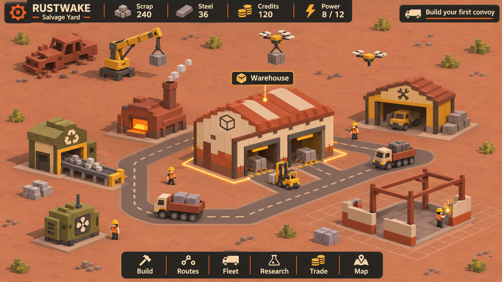

# RUSTWAKE V2 — Living Industrial World

This is a **new 3D sandbox app foundation**, not an edit of the previous flat-grid React UI.

The approved image is the style target—not a fake game background or proof that this version matches it yet.

## Foundation

Three.js full 3D orthographic yard with default 45° yaw and 35.264° elevation; orbit, pan, tilt, zoom; a 24×24 industrial parcel; roads, visible trucks moving conserved cargo, crane and machine animations; machine construction, production and trading; research, 17 registered currencies and modular blueprint UI. React's HUD is written fresh and overlays the world, with responsive phone and desktop controls.

## Quick start

- Run `npm ci && npm run dev` and open `http://localhost:5173/rustwake/`.
- Run `npm run validate && npm test && npm run build`.
- Production target: https://home.darkmatter2222.com/rustwake/

## Archive and recovery

All existing files from main commit 0da976d94b708951540ff8781f64ed27c3468f16 are preserved in [archive/legacy-v1-2026-11-15](archive/legacy-v1-2026-11-15) as a nested Git tree; the same original is also preserved as branch archive/rustwake-v1-2026-11-15. V2 does not compile old source or touch legacy browser saves.

## Release rule

No direct pushes to main. A release engineer merges independently reviewed PRs, tracks main CI/CD through deployment, checks exact served artifact hashes and browser evidence. Final G1 requires actual sponsor visual acceptance of the integrated 3D sandbox—not an isolated prototype or a test screenshot.

V2 is an initial vertical-slice foundation. Deep research/expansion, user routes, full staged assembly, physical-phone acceptance, expeditions, PvP and long-term economy remain roadmap deliverables. See docs/ (forthcoming).

## Living Industrial City — next evolution

The executive sponsor has expanded Rustwake into an **emergent 3D industrial city**. The game will support player-drawn truck routes/waypoints, actual freight loading and unloading, walking citizens with work/home routines, zoning, roads and traffic control, vehicle collisions and repairs, power/water/civic services, weather/pollution, natural and industrial disasters, public demonstrations/labor disputes and fair fictional civic unrest with emergency response. These are planned **actual game systems**, not all currently delivered. The existing V2 isometric world and approved reference image remain the visual authority.

- [Product vision and practical constraints](docs/city/LIVING_INDUSTRIAL_CITY.md)
- [Deterministic city simulation architecture](docs/city/SYSTEM_ARCHITECTURE.md)
- [Playable integrated acceptance scenarios](docs/city/ACCEPTANCE_SCENARIOS.md)
- [Issue audit and scoped workstreams](docs/city/ISSUE_AUDIT.md)
- [192-task execution DAG](docs/city/execution-manifest.json) — see [execution program #310](https://github.com/darkmatter2222/Rustwake/issues/310)
- [Native GitHub Projects migration runbook](docs/city/PROJECT_MIGRATION.md) — Projects board remains **unverified** pending authorized CLI bootstrap.
- [Portable sponsor handoff](docs/city/AUTONOMOUS_HANDOFF.md) for Qwen/OpenCode/other supported coordinator harnesses.

Complete and visually validate first-playable G1 before allowing city/disaster scope to keep the public game in a perpetual prototype state. Developer tasks require a current accepted blocker chain, isolated PR, independent QA/product and deployed-SHA evidence. One coordinator plus four rotating specialists maximum; existing PRs #307 (camera) and #309 (studio roles) are independent in-flight work.
