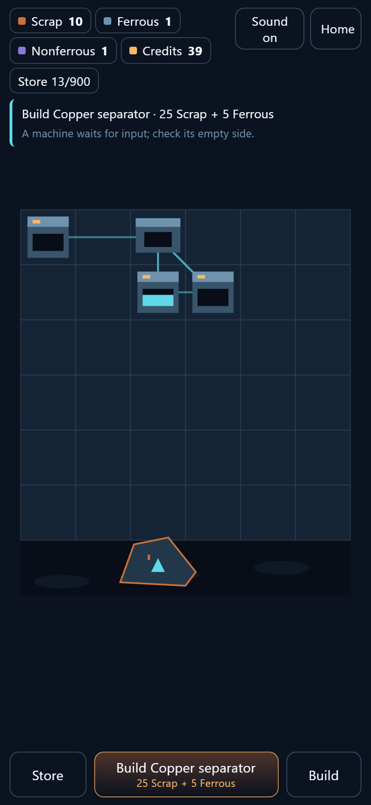

# Rustwake

A full-screen, mobile-first browser idle salvage game. You operate a small recovery
outfit: cut scrap from wrecks, repair a drone, let it work for you, then build and
connect processing machines into a yard that keeps producing while you plan.



Prototype build: React 18 + TypeScript + Vite, Canvas 2D world, deterministic integer
simulation core. English only so far. No account, no server, no payments yet.

## Current playable loop (implemented)

1. **Begin recovery** on the start gate; this also unlocks audio.
2. **Tap the wreck** (or press *Salvage*) to fire a cutting pulse. Each pulse gives
   5 scrap with a 0.6 s recharge, six pulses giving the 30 scrap needed for repair.
3. **Repair drone** for 30 scrap. The drone then extracts 5-unit loads every 5 s and
   flies them to the dock, which is visibly filled by the delivered cargo.
4. **Build sorter** (20 scrap) on a free yard tile using the placement ghost.
5. **Connect dock to sorter** to create two real routes (scrap in, ferrous out) with
   capacity, latency, and visible cargo movement.
6. **Build furnace** and connect it, then **Sell steel** to earn the first 30 credits.
7. **Upgrade a machine** with those credits. Upgrades change speed only
   (`ceil(base * 1.16^(level-1))` cost, `1 + 0.10 * (level-1)` speed).
8. **Extend the chain**: the copper separator (2 nonferrous → 1 copper + 1 residue),
   the polymer recycler (3 residue → 1 polymer), and the wire mill (1 copper → 3 wire)
   unlock in that order, each with its own route and its own upgrade price.
9. **Sell a surplus** from the store panel at published per-unit prices, then spend the
   credits on whichever machine is the current bottleneck.

After the tutorial, one authoritative ladder decides the next step for both the objective
card and the dock button: an unmet link first, then an affordable build, then a sell
tranche, then an upgrade. The two surfaces cannot disagree.

Implemented systems: manual salvage with cooldown, drone automation, machine
construction/upgrade/dismantle/move, 1×1 placement on a 6×6 yard with a protected dock
tile, route logistics with capacity/latency/filters/fair allocation, shared power budget
with proportional slowdown, storage capacity plus an overflow hold, one-shot onboarding
export contract plus repeatable priced sell contracts, seven blueprints with a progressive
build picker, tutorial state machine (T0-T9), contextual objective card, one localised
explanation per blocked action, single-canvas HUD, local save with a return report and a
12-hour offline cap, and a synthesised audio bus with a bounded voice pool.

Planned, not yet functional: research tree, expeditions/sector map, wreck composition
and scan detail, restore/dismantle/sell choices for major objects, policies, prestige,
crews, PvP, store. Those are later milestones in `goal.md` (M2+).

## Milestone and next three goals

Active milestone: **M2 — a useful small factory** (M0 and M1 complete).

1. **B-03 bottleneck assistant**: one evidence line per machine (measured occupancy,
   starvation percentage, power ratio) plus one recommendation that is not always a purchase.
2. **B-01 multi-tab single-writer lease**: owner id plus heartbeat, a read-only second tab,
   revision-checked takeover, tests for both paths.
3. **B-05 small research branch**: three purchasable nodes with exact visible effects,
   each applied exactly once, funded by data.

## Controls

| Input | Behaviour |
| --- | --- |
| Tap/click object | Select it; the world object shows a high-contrast outline and its panel opens |
| Tap the wreck | Manual cutting pulse (when a pulse is ready) |
| Drag one finger | Pan the camera, clamped to the yard |
| Pinch / two-finger drag | Zoom between 1.2x and 6x |
| Primary dock button | The single next action for the current objective, with cost |
| Store | Bulk-material sheet with per-material **Sell** buttons, capacity, overflow hold |
| Machine panel | Status, batch progress, measured and maximum rate, power share, **Connect**, **Upgrade**, **Dismantle** |
| Build / Place / Next / Cancel | Blueprint selection, ghost confirmation, cycling, abort |
| Sound on/off | Toggles the master bus, persisted |
| Home | Recentres the camera on the yard and clears selection |

Keyboard: standard focus order over the semantic buttons (`Tab`), activation with
`Enter`/`Space`. Reduced-motion is honoured for the drone and cargo interpolation; the
economy never depends on animation timing.

## Run it

```bash
npm ci        # install
npm run dev   # http://localhost:5173
npm test      # 66 unit/integration tests
npm run typecheck
npm run build # dist/ (191.89 kB JS, 60.75 kB gzip)
npm run preview
```

Save state lives in `localStorage` under `rustwake.save.v1` as a checksummed envelope
`{schemaVersion, checksum, payload}`. Corrupt or newer-version envelopes are rejected and
a fresh session starts without overwriting the stored raw text until the next successful
checkpoint. On load, one bounded catch-up runs and the reference clock advances through
the entire absence, so repeated reloads cannot double-claim the discarded tail.

To capture the README screenshots: `npm run preview` in one terminal, then
`node scripts/capture.mjs`.

## Latest update (M2 start: copper and polymer chain, 2026-11-03)

- Chain content is now reachable in play: copper separator, polymer recycler, and wire
  mill are buildable, each with its own route and upgrade price, and the build picker
  reveals blueprints progressively (1 → 2 → 4 → 5 → all seven) as the tutorial advances.
- Repeatable sell contracts at content-defined one-way prices (`steel 10`, `copper 6`,
  `polymer 8`, `wire 4`, …), opening after the onboarding contract. Each tranche is capped
  at 60 units and keeps a 10-unit per-material reserve floor so routes and builds stay
  funded. Because materials are never repurchased, the recipe graph cannot form a credit
  loop; a test walks it for cycles.
- One shared yard ladder (`game/simulation/plan.ts`) drives both the objective card and
  the dock label, so the stated goal and the primary button are always the same step.
- Machine panel gained a **Connect** action plus a "next upgrade" line showing the actual
  cycle change (for example `4.00s → 3.64s · 45 credits`).
- Defect fixed from the real-browser run: the action toast timer was re-armed on every
  animation-frame render, so it never dismissed. It now depends only on the toast text,
  with a regression test that advances 1.9 s of frames.
- Measured chain throughput in a deterministic fixture (1 200 ticks, seeded store):
  sorter 29, copper separator 23, wire mill 12, polymer recycler 14 completed batches;
  the mill and recycler sit at their supply limits, the first two at their cycle limits.
- Checks: `npm test` 66 passed / 66 (8 files), `npm run typecheck` clean,
  `npm run build` 191.89 kB JS (60.75 kB gzip).

Known limitations: no research/expedition/crew/PvP/store UI yet; no multi-tab lease; the
no-scroll gate is only structurally verified in jsdom, so a real-device trace is still
pending; audio quality is unverified by human listening; `data`, motors, battery, plates,
alloy, and chassis exist as content but are not reachable until the plate press, motor
bench, and signal lab blueprints arrive.

## Measured numbers (Node 22.18 on the development machine, `tests/perf/bench.test.ts`)

These are headless CPU costs for the simulation core, not mobile FPS claims.

| Workload | Median of 3 |
| --- | --- |
| 12 h catch-up, 4-machine starter yard, tick-by-tick | 28 ms |
| 12 h catch-up, idle yard, event-jump path | < 1 ms |
| 500 machines, 6 000 ticks | 19 ms |
| 100 machines, 10 000 ticks | 6 ms |
| 50 machines, 10 000 ticks | 3 ms |
| 1 machine, 10 000 ticks | 0.4 ms |

## Screenshot gallery

| File | Capture size | Scenario | Source |
| --- | --- | --- | --- |
| `docs/screenshots/latest-mobile.png` | 390 × 844 @2x | Scripted session to tutorial step 8: 3 machines (sorter, furnace, polymer recycler), 6 routes, 39 credits, tick 1008 | Same commit as this README, Chrome headless via `scripts/capture.mjs`, captured 2026-11-03 |
| `docs/screenshots/latest-desktop.png` | 1440 × 900 @1x | Same scripted sequence, wide viewport, same session state | Same commit as this README, Chrome headless, captured 2026-11-03 |

Screenshots demonstrate appearance only: they do not prove audio, persistence, or
long-session behaviour, which are covered by the tests above. The previous M1 pair
(2026-11-02, two machines, tick 750) is superseded by these captures.

## Architecture

```
src/
  app/store.ts            authoritative state owner, frame loop, save cadence
  game/content/defs.ts    resources, recipes R01-R12, blueprints, tuning
  game/simulation/        types, engine (tick phases), commands, offline, invariants, autoconnect, plan
  game/renderer/scene.ts  camera, world/sprite drawing, ports
  game/audio/audio.ts     buses, cue table, bounded voice pool
  game/persistence/save.ts envelope, checksum, validation, migration hook
  ui/                     App shell, HUD parts, panels, text, store hooks
tests/                    simulation, logistics, offline, persistence, ui, perf
scripts/capture.mjs       playwright-core screenshot capture
docs/                     STATUS, BACKLOG, DECISIONS, BLOCKERS, ARCHITECTURE, screenshots
```

State flow: pointer intent → validated command → simulation transaction → new revision →
subscribed HUD summary plus renderer snapshot → persistence checkpoint. The renderer reads
the mutable state object each frame; React re-renders from a numeric view version, so
moving sprites do not re-render components (see `docs/ARCHITECTURE.md`).

Deeper notes: [ARCHITECTURE](docs/ARCHITECTURE.md),
[STATUS](docs/STATUS.md), [BACKLOG](docs/BACKLOG.md),
[DECISIONS](docs/DECISIONS.md), [BLOCKERS](docs/BLOCKERS.md).
